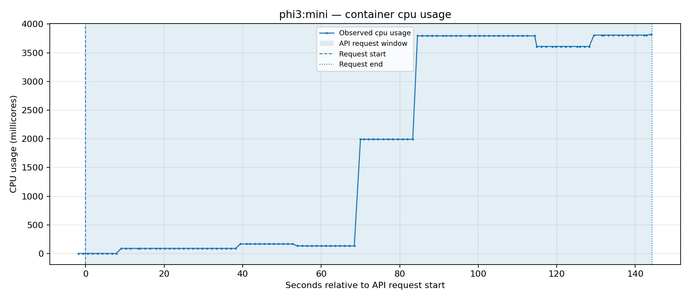
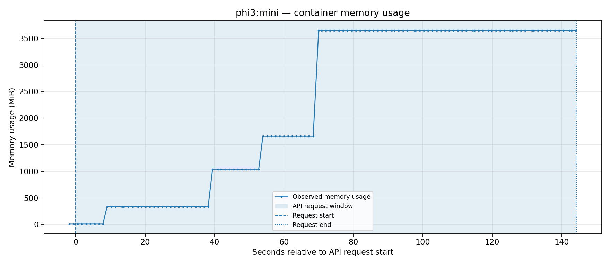
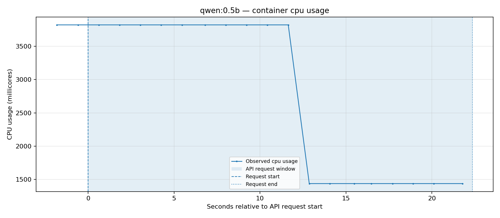
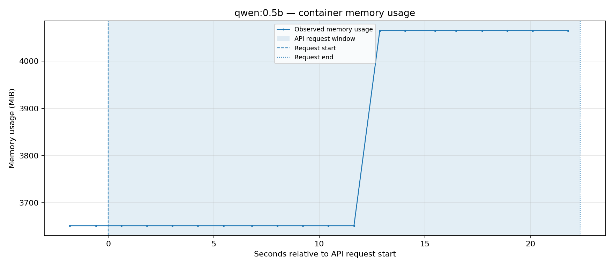
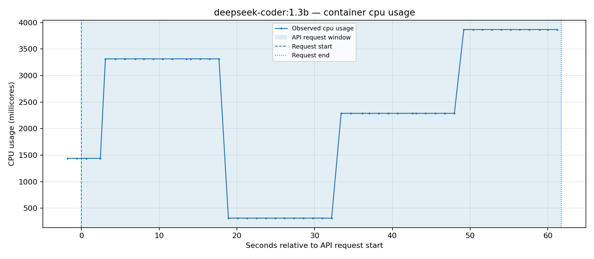
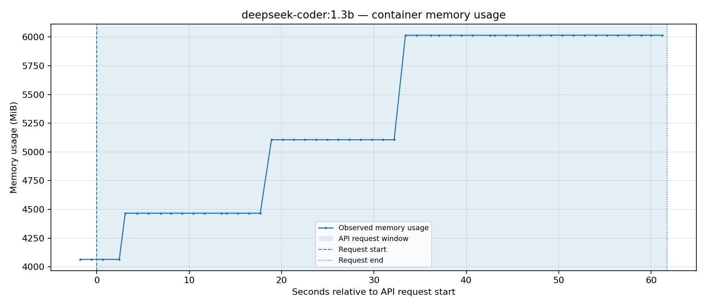
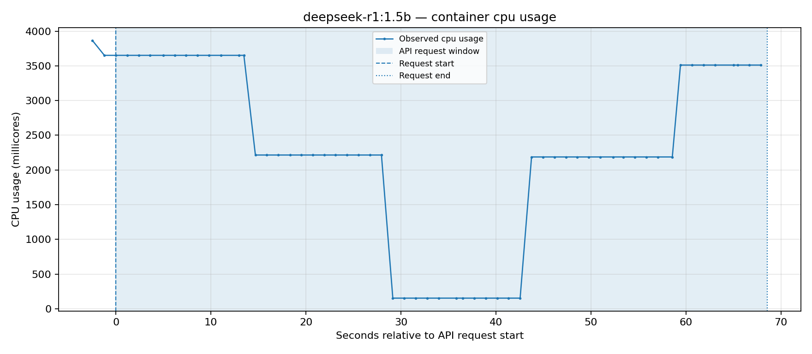
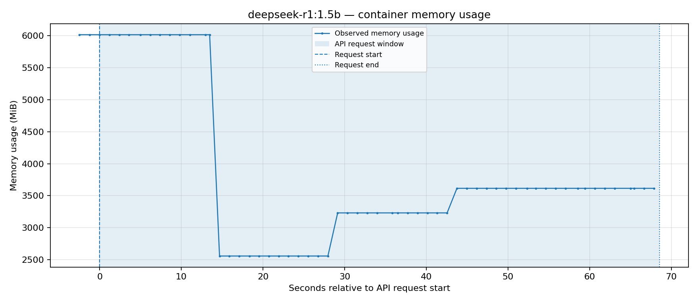

# Ollama on Kubernetes — Raspberry Pi 4B experiment

**Experiment date:** 7 November 2026  
**Workload:** Ollama inference through the Kubernetes Service  
**Node:** `c2worker1` (Raspberry Pi 4B, as identified for this experiment)  
**Models tested:** 4  
**Data sources:** `inference.csv`, four `resources-*.csv` files, and `ollama.test-models-output.txt` supplied with this analysis.

## Executive summary

This experiment ran four small language models through Ollama on a Kubernetes cluster, with container resource usage sampled using `kubectl top pod --containers`.

The fastest observed generation throughput was **Qwen 0.5B at 9.04 tokens/s**. Phi-3 Mini was slowest at **1.51 tokens/s**. These are results from one request per model, not repeatable benchmark results.

The results are useful as an initial homelab experiment, but they are not yet a controlled model benchmark. Model loading time is substantial, only one request was run for each model, the output cap was 128 tokens, and the tests were run sequentially with Ollama configured to keep models alive.

## 1. Accessing the Ollama API from the workstation

The Ollama Kubernetes Service is a `ClusterIP`, so its DNS name is reachable from within the cluster, not directly from the workstation.

Before running `ollama-test.sh`, open a separate terminal and keep this command running:

```bash
kubectl port-forward -n ollama svc/ollama 11434:11434
```

The test script can then call the API through:

```text
http://localhost:11434/api/generate
```

The port-forward process must remain active for the duration of the experiment. This provides a local tunnel to the Service; it does not expose Ollama as a permanent external endpoint.

## 2. Inference results

All four tests used the prompt:

> Explain Kubernetes architecture.

The script set `stream: false`, `temperature: 0`, `seed: 42`, and `num_predict: 128`.

| Model | Client request time (s) | Model load (s) | Generation (s) | Output tokens | Generation speed (tokens/s) |
|---|---:|---:|---:|---:|---:|
| phi3:mini | 144.20 | 55.12 | 84.69 | 128 | 1.51 |
| qwen:0.5b | 22.32 | 12.61 | 9.29 | 84 | 9.04 |
| deepseek-coder:1.3b | 61.67 | 22.03 | 32.06 | 128 | 3.99 |
| deepseek-r1:1.5b | 69.24 | 28.56 | 39.72 | 128 | 3.22 |

### Interpretation

- **Qwen 0.5B** had the shortest client request time (22.32 seconds) and highest generation throughput (9.04 tokens/s).
- **Phi-3 Mini** was the slowest in this run: 144.20 seconds end-to-end and 1.51 tokens/s during generation.
- **DeepSeek Coder 1.3B** generated at 3.99 tokens/s.
- **DeepSeek R1 1.5B** generated at 3.22 tokens/s.

Model loading was a material part of elapsed time: between 12.61 and 55.12 seconds. Therefore, reporting only total request time would mix model-loading overhead with prompt processing and token generation.

The `curl_seconds` values measure client-observed HTTP duration. Ollama's `load_duration`, `prompt_eval_duration`, and `eval_duration` are server-reported durations. They are related but are not interchangeable.

### Output-length limitation

Three models produced exactly 128 output tokens, matching the configured `num_predict: 128` ceiling. Their responses in the execution log are truncated at that limit. Qwen produced 84 tokens. In the execution log, the DeepSeek R1 run also shows a blank printed response even though Ollama reports 128 evaluated output tokens. The supplied log does not include the raw JSON response, so it is not possible to determine whether the generated content was placed in another response field (for example, a separate thinking field), was empty in `response`, or was omitted by the logging step. Inspect and retain the raw API response before making any claim about this model's answer quality.

Consequently, this experiment does **not** establish which model gave the best or most complete explanation. It measures latency and throughput for this request configuration, not answer quality. A quality comparison needs a task-specific evaluation and a generation limit high enough to avoid truncating answers.

## 3. Kubernetes resource measurements

The resource CSVs contain container-level samples from `kubectl top pod --containers`. The charts below plot CPU and memory independently for each model. The shaded region represents the API request interval, using the timestamps in `inference.csv`.

| Model | Samples inside request | Median sample interval | Mean CPU | Max CPU | Mean memory | Max memory |
|---|---:|---:|---:|---:|---:|---:|
| phi3:mini | 119 | 1.20 | 1828m | 3820m | 2260 MiB | 3651 MiB |
| qwen:0.5b | 18 | 1.21 | 2762m | 3820m | 3835 MiB | 4065 MiB |
| deepseek-coder:1.3b | 51 | 1.20 | 2391m | 3866m | 5330 MiB | 6016 MiB |
| deepseek-r1:1.5b | 56 | 1.20 | 2234m | 3651m | 3778 MiB | 6016 MiB |

### Resource limits: the supplied manifest is an earlier configuration

The Deployment YAML previously supplied for review showed:

- CPU request: `250m`; CPU limit: `1000m`
- Memory request: `2Gi`; memory limit: `4Gi`

You subsequently clarified that the Deployment CPU and memory limits were increased before the measurements represented in these resource logs. Therefore, the earlier YAML is not the configuration snapshot that should be used to interpret the observed usage. The resource readings reaching approximately **3,866m CPU** and **6,016Mi memory** are not, by themselves, evidence of a Kubernetes resource-limit violation.

The exact updated limits were not provided with the dataset, so this report does not state what limits were active during the tests. For a reproducible report, capture the live configuration alongside the measurements:

```bash
kubectl get deployment ollama -n ollama -o yaml
kubectl get pods -n ollama -l app=ollama -o wide
kubectl describe pod -n ollama -l app=ollama
```

Inspect the running Pod's container `resources.requests` and `resources.limits`, and record those values with the experiment. The plots retain reference lines for the *earlier* 1,000m CPU and 4,096Mi memory limits only as historical context; they are not asserted to be the limits used during these runs.

### Interpreting the resource charts

- CPU is reported in millicores (`1000m` = one CPU core). Values around `3800m` indicate usage close to four cores, if the metrics and units are accurate.
- Memory is reported in MiB. The maximum observed value, `6016Mi`, is approximately 5.88 GiB.
- The first samples can occur before the API request begins. They are retained in the plots to show the lead-in and the state inherited from the preceding test.
- The resource logs are sequential. The memory baseline for a model may include Ollama runtime state and models loaded by earlier tests, rather than only the model named in that CSV.
- The Deployment was configured with `OLLAMA_KEEP_ALIVE=1h` in the supplied manifest. If that setting was active, models could remain loaded between tests. This makes per-model memory attribution especially unreliable.
- `kubectl top` is a sampled view backed by Metrics Server. The approximately 1.2-second interval between rows does not mean the underlying metrics are instantaneous or have one-second precision. Short peaks can be missed, and adjacent samples can reflect a recent measurement window.

## 4. Per-model resource plots

### phi3:mini

**CPU usage**



**Memory usage**



### qwen:0.5b

**CPU usage**



**Memory usage**



### deepseek-coder:1.3b

**CPU usage**



**Memory usage**



### deepseek-r1:1.5b

**CPU usage**



**Memory usage**




## 5. What can and cannot be concluded

### Supported by this dataset

1. All four models responded through the Ollama API on the Kubernetes-hosted service.
2. Qwen 0.5B had the highest observed generation throughput in these runs.
3. Phi-3 Mini had the lowest observed generation throughput and longest request duration.
4. Model loading contributed materially to total request time.
5. The Ollama container showed substantial CPU and memory consumption during the experiment.
6. The measured CPU and memory usage reached 3,866m and 6,016Mi respectively; the exact updated limits active during the tests were not included in the supplied dataset.

### Not established by this dataset

1. A stable performance ranking across repeated runs.
2. A fair comparison of answer quality.
3. Exact peak CPU or memory usage.
4. The isolated memory footprint of each model.
5. Whether the bottleneck is CPU, memory bandwidth, thermal throttling, model quantization, or another hardware/runtime factor.
6. Whether the updated resource limits were sufficient to avoid CPU throttling or memory pressure; the exact updated limits and throttling/OOM evidence were not supplied.

## 6. Recommended next experiment

For a more defensible comparison:

1. Verify the live Deployment's CPU and memory requests/limits.
2. Record the Raspberry Pi 4B RAM size, OS/architecture, Ollama image version, and exact model tags/quantization.
3. Run one model at a time and explicitly unload it between model tests, or restart Ollama between cold-start tests. Keep cold-start and warm-run measurements separate.
4. Run at least five warm requests per model, using the same prompt and generation settings.
5. Use a prompt that requires a predictable output length, and avoid a token cap that truncates the responses.
6. Record the Ollama response fields `total_duration`, `load_duration`, `prompt_eval_count`, `prompt_eval_duration`, `eval_count`, and `eval_duration`.
7. For resource analysis, use Prometheus/cAdvisor or another time-series monitoring system if you need reliable historical sampling and peak analysis. Treat `kubectl top` as a convenient spot-check, not a high-resolution profiler.
8. If comparing model quality, define a separate evaluation rubric; throughput alone does not measure usefulness.

## 7. References

- [Ollama Generate API](https://docs.ollama.com/api/generate) — response fields and generation options.
- [Kubernetes `kubectl top`](https://kubernetes.io/docs/reference/kubectl/generated/kubectl_top/) — resource metrics reported for Pods and containers.
- [Kubernetes resource management](https://kubernetes.io/docs/concepts/configuration/manage-resources-containers/) — CPU and memory requests and limits.


## 8. Additional Resources

- [Ollama K8s Manifests](https://github.com/MyProgrammingProjects/k8s_notes/tree/main/ollama/k8s-manifests)
- [Bash Script to Models Tests](https://github.com/MyProgrammingProjects/k8s_notes/tree/main/ollama/scripts)


---

**Bottom line:** this is a useful first experiment showing the practical constraints of running local LLM inference on Raspberry Pi hardware. It is not yet a controlled benchmark. The earlier Deployment YAML was superseded by a configuration with higher CPU and memory limits. Record the exact active limits with the next run, then repeat the tests under controlled cold/warm conditions.

